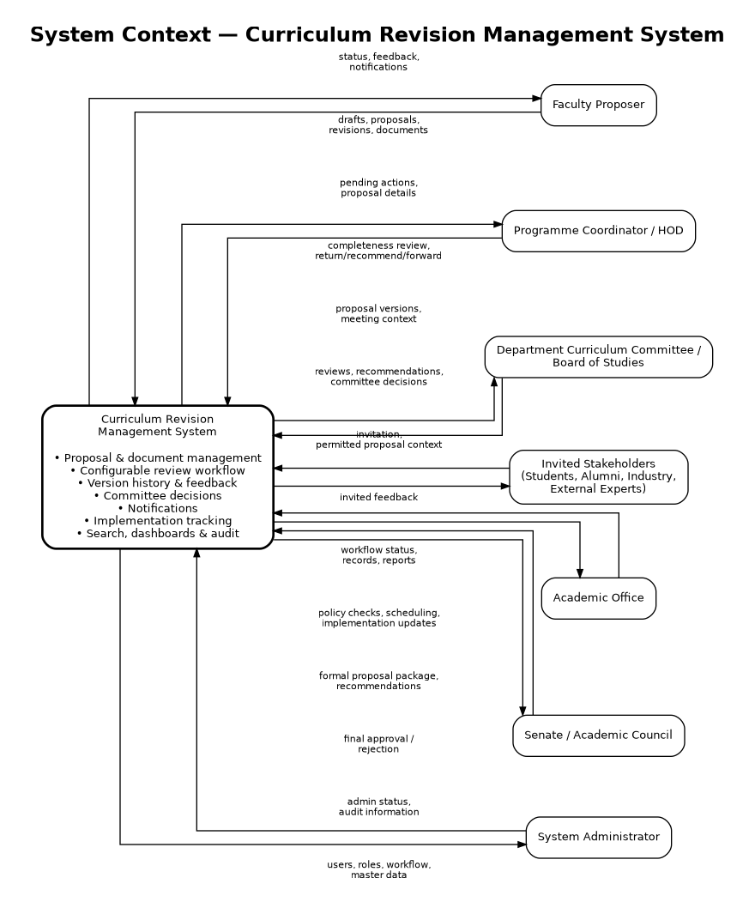

# Curriculum Revision Management System (CRMS)

[](https://github.com/utkarshtyagi-253/curriculum-revision-management-system/actions/workflows/ci.yml)


A role-based platform for proposing, reviewing, approving, versioning and implementing academic curriculum changes. This repository contains documentation through **Assignment 05**, the **React 19 + Express + SQLite application**, and the earlier **Python/FastAPI prototype**.

## Team details

**Course:** CS314 — Software Development Laboratory, The LNM Institute of Information Technology, Jaipur
**Team ID:** T017
**Development model:** Agile — Iterative and Incremental Development

| Member | Roll number | Assignment 01–02 responsibility baseline |
| --- | --- | --- |
| Utkarsh | 24UCC096 | Requirements and analysis, access control and business rules |
| Piyush | 24UCC097 | Workflow, architecture, versioning and data requirements |
| Yash | 24UCC099 | Documentation, use cases, acceptance criteria and traceability |
| Mehul | 24UCC100 | Quality, security, performance, usability and auditability |

## Assignment deliverables through Assignment 05

| Assignment | Focus | Deliverable |
| --- | --- | --- |
| **01** | Project identification and initial definition | [Project Definition](docs/assignment-01/Project-Definition.md) |
| **02** | Requirements specification and traceability | [SRS v1.0](docs/requirements/SRS-v1.0.md) · [System Context](docs/requirements/diagrams/System-Context.png) |
| **03** | Scenarios, use-case and activity modelling | [Scenario, Use Case and Activity Modelling](docs/assignment-03/Scenario-Use-Case-Activity-Modelling.md) |
| **04** | Classes, object diagram and relationships | [Classes, Object Diagram and Relationships](docs/assignment-04/Classes-Object-Diagram-Relationships.md) |
| **05** | Collaboration/communication, state and component modelling | [Collaboration, State and Component Modelling](docs/assignment-05/Collaboration-State-Component-Modelling.md) · [Assignment 05 PDF](T017_assignment05.pdf) |

The modelling documents carry forward **UC-005 — Submit Proposal**, **UC-009 — Review Proposal and Record Feedback**, and **UC-015 — Record Committee Decision**. Assignment 05 describes their collaborating objects, proposal state transitions and component responsibilities.

Earlier submission PDFs: [Assignment 01](docs/pdf/T017_Assignment01.pdf), [Assignment 02](docs/pdf/T017_ASSIGNMENT02.pdf), and [Combined Assignments 01–02](docs/pdf/T017_CS314_Assignment_01_02_Complete.pdf).

## Problem and stakeholders

Curriculum revisions often rely on scattered email threads, spreadsheets, meeting minutes and paper records. CRMS centralizes proposal versions, feedback, decision ownership and implementation tracking.



| Stakeholder | Responsibility |
| --- | --- |
| Faculty Proposer | Create drafts, attach documents, submit and revise returned proposals |
| Programme Coordinator / HOD | Perform department review and recommend or return proposals |
| DCC / Board of Studies | Evaluate academic merit and record recommendations, conditions and meeting context |
| Academic Office | Perform academic scrutiny, forward proposals and track implementation milestones |
| Senate / Academic Council | Record final approval or rejection |
| System Administrator | View workflow configuration, manage departments/courses and inspect audits |
| Invited students, alumni and industry | Provide contextual feedback in the requirements model; external onboarding is outside the current implementation |

## Assignment 05 application

The React application provides:

- JWT authentication and server-side role/stage authorization.
- Draft saving, academic-field validation and PDF, text or DOCX attachments up to 5 MB.
- Immutable submission/resubmission snapshots and field comparison between versions.
- Pending reviews, feedback, forwarding and return/rejection with required reasons.
- Committee decisions with meeting reference/date and conditions for conditional approval.
- Senate-only final approval, with repeated or stale decisions blocked.
- Implementation milestones with evidence required for completion.
- Notifications with persistent read status, proposal timelines, decision history and audit views.
- Administrator department/course management and read-only workflow configuration.

### Workflow demonstration

1. **Faculty** creates a proposal, completes academic fields, attaches documents and submits. A version is sealed and department review is assigned.
2. **HOD** recommends it or returns it with a reason. Faculty can edit and resubmit returned proposals, creating another immutable version.
3. **DCC** records a recommendation or conditional approval with meeting context, or returns/rejects it.
4. **Academic Office** reviews and forwards it to Senate.
5. **Senate** records final approval or rejection.
6. **Academic Office** tracks implementation milestones for approved proposals.

### Architecture

The React/Vite client calls `/api` through the development proxy. Express routes delegate to `ProposalService`, `WorkflowService` and `CommitteeService`. SQLite persists demo data, including document data URLs. Transactions keep snapshots, decisions, pending actions, notifications and audits consistent when a transition fails.

The broader SRS domain model covers users/roles, academic master data, proposals, versions, documents, workflow stages, feedback, meetings/decisions, notifications, milestones and audit events. Assignment 04 describes class/object relationships; Assignment 05 describes collaboration, states and components.

## Run the React application locally

**Prerequisites:** Node.js 22 or newer, npm and Git.

```powershell
git clone https://github.com/utkarshtyagi-253/curriculum-revision-management-system.git
cd curriculum-revision-management-system
npm install --prefix server
npm install --prefix client
npm start --prefix server
```

In a second terminal, from the repository root:

```powershell
npm run dev --prefix client
```

Open **http://localhost:5173**. The API runs on **port 8000**; stop the Python server first if it uses that port. An empty database is seeded automatically, and existing data is preserved.

To deliberately reset **all application data** to the demo baseline:

```powershell
npm run seed --prefix server
```

### Demo accounts

| Role | Email | Password |
| --- | --- | --- |
| Faculty | faculty@lnmiit.ac.in | Faculty@123 |
| HOD | hod@lnmiit.ac.in | Hod@123 |
| DCC | dcc@lnmiit.ac.in | Dcc@123 |
| Academic Office | academics@lnmiit.ac.in | Academic@123 |
| Senate | senate@lnmiit.ac.in | Senate@123 |
| Administrator | admin@lnmiit.ac.in | Admin@123 |

Quick-login buttons use these credentials for academic demonstration.

### Build and validation

```powershell
npm run build --prefix client
npm test --prefix server
```

Server tests use an in-memory database without resetting development data. Regression coverage includes snapshot preservation on resubmission, partial draft saves, invalid-action rollback, role/stage checks, final approval, document bytes and milestone evidence validation.

The existing GitHub Actions workflow runs the **Python pytest suite**. Run the React build and Node tests separately using the commands above.

See [REACT-README.md](REACT-README.md) for the detailed application guide and [DEPLOYMENT.md](DEPLOYMENT.md) for Render deployment. The free-demo configuration uses ephemeral storage, so online data can be lost after restarts or redeployment.

## Earlier Python/FastAPI prototype

Use Python 3.10+ and run from the repository root:

```powershell
pip install -r requirements.txt
python scripts/seed_data.py
uvicorn src.main:app --reload --port 8000
```

Swagger UI: **http://127.0.0.1:8000/docs**
OpenAPI specification: **http://127.0.0.1:8000/openapi.json**

```powershell
pytest -v
```

## Repository structure

```text
curriculum-revision-management-system/
├── .github/workflows/ci.yml        # Python CI
├── docs/
│   ├── assignment-01/             # Project definition
│   ├── requirements/              # SRS and system context
│   ├── assignment-03/             # Scenarios, use cases and activities
│   ├── assignment-04/             # Classes, objects and relationships
│   ├── assignment-05/             # Collaboration, states and components
│   └── pdf/                       # Earlier submission PDFs
├── client/                        # React/Vite frontend
├── server/
│   ├── src/                       # Express routes, services and SQLite database
│   └── tests/                     # API and Assignment 05 regression tests
├── src/                           # Earlier FastAPI prototype
├── tests/                         # Python tests
├── scripts/seed_data.py            # Python seed script
├── T017_assignment05.pdf           # Assignment 05 submission
├── render.yaml                    # Render deployment configuration
├── DEPLOYMENT.md                   # Deployment guide
├── REACT-README.md                 # Detailed React application guide
├── requirements.txt               # Python dependencies
└── README.md
```

## Implementation scope

Institutional SSO, email delivery, ERP write-back and production file storage are not connected. Workflow configuration is read-only; master-data editing covers departments and courses. Invited stakeholder onboarding and user/role administration remain outside this implementation. For public deployment, remove demo login, configure a deployment JWT secret and review the dependency-audit notes in [REACT-README.md](REACT-README.md).

## AI usage declaration

AI tools, including ChatGPT, supported documentation formatting, language refinement, completeness checks and implementation assistance. Team T017 is responsible for reviewing and verifying the submitted requirements, models and implementation against the course policy.

**Team representative:** Yash Gupta
**Documentation coverage:** Assignments 01–05
