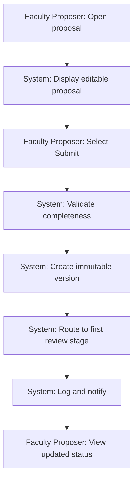
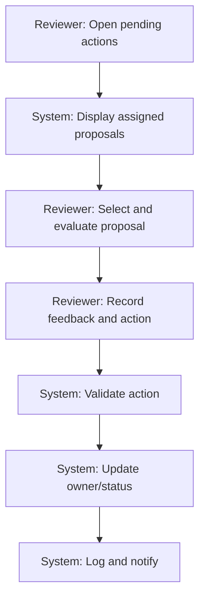
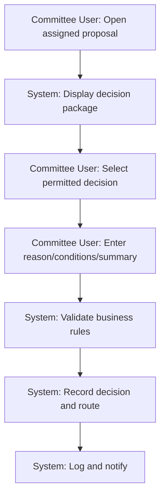
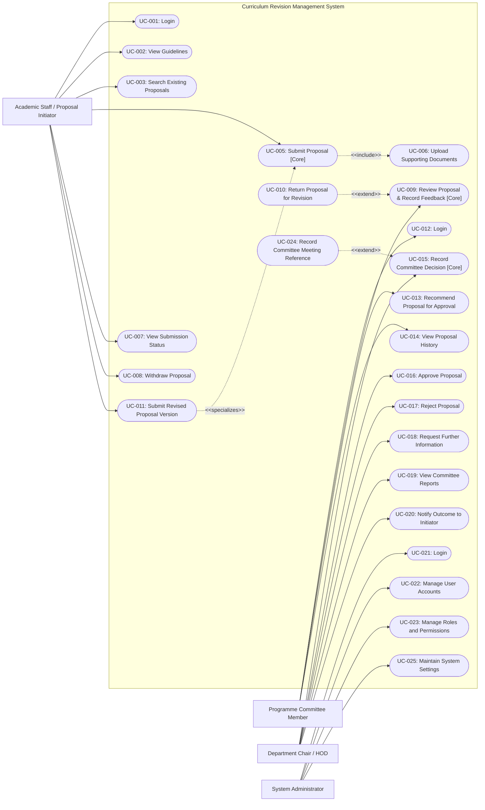
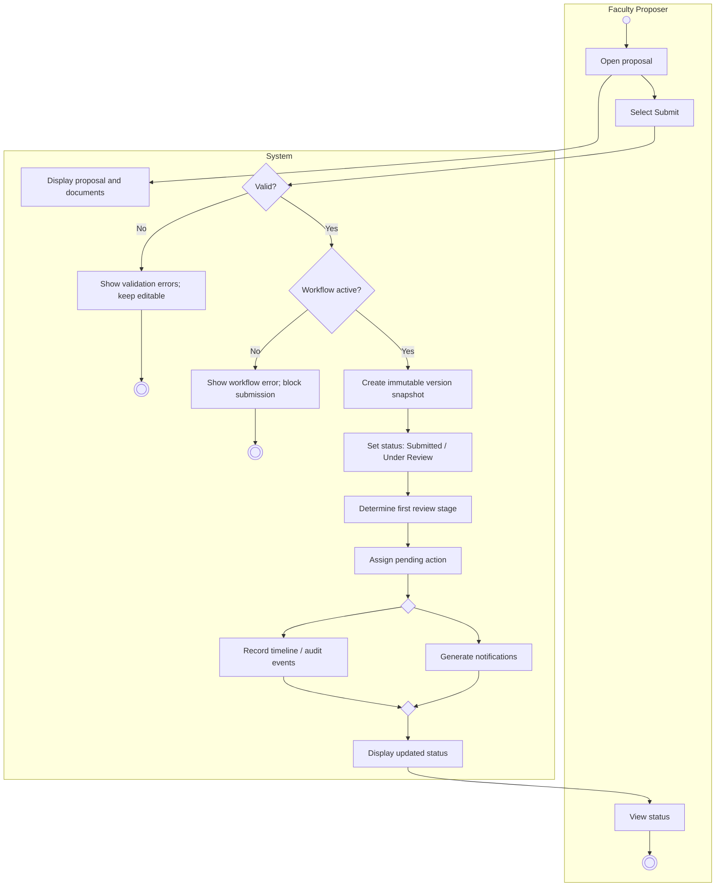
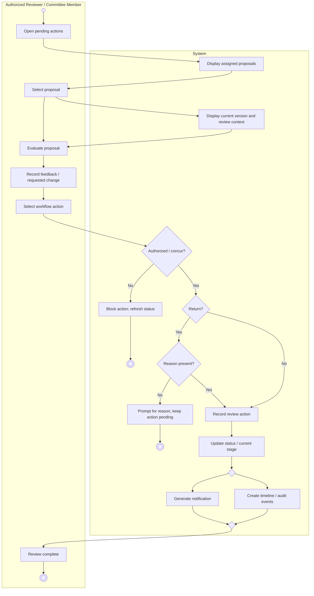
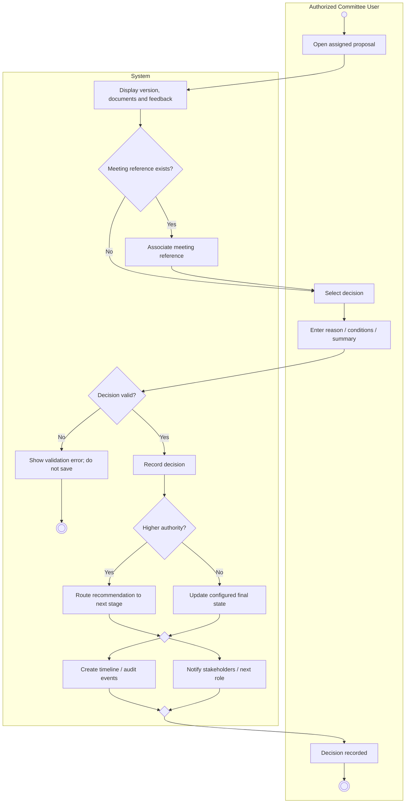

# The LNM Institute of Information Technology, Jaipur
## Software Development Laboratory
**Course Code:** CS314  
**Lab Assignment 3:** Scenario, Use Case and Activity Modelling  
**Project:** Curriculum Revision Management System  
**Team ID:** T017  
**Team Members:** Utkarsh, Piyush, Yash, Mehul  
**Roll Numbers:** 24UCC096, 24UCC097, 24UCC099, 24UCC100  
**Development Model:** Agile - Iterative and Incremental Development  
**Date:** 12 September 2026  

---

## 30. Scenarios

The three detailed use cases defined in Assignment 2 are carried forward without introducing new functionality:
- **UC-005:** Submit Proposal
- **UC-009:** Review Proposal and Record Feedback
- **UC-015:** Record Committee Decision

---

### Scenario: UC-005 — Submit Proposal

| Field | Description |
|---|---|
| **Actor(s) involved** | **Primary:** Faculty Proposer. **Supporting:** Curriculum Revision Management System. |
| **Starting condition** | The Faculty Proposer is authenticated, owns the proposal, the proposal is in `Draft` or `Returned for Revision` status, and the applicable review workflow is configured and active. |
| **Main sequence of activities** | 1. The proposer opens the proposal. 2. The system displays the current editable proposal data and supporting documents. 3. The proposer selects **Submit**. 4. The system validates all mandatory fields and required information for the selected proposal type. 5. The system creates an immutable proposal-version snapshot (`v1`, `v2`, etc.). 6. The system changes the proposal status to `Submitted / Under Review`. 7. The system determines the first configured review stage and responsible role. 8. The system assigns the pending action to that stage. 9. The system records submission and version events in the timeline and audit trail. 10. The system generates relevant in-application notifications. 11. The system displays confirmation and the updated current status. |
| **Important alternative / exception flows** | • **Mandatory data missing:** submission is blocked and the missing or invalid fields are identified. • **Invalid supporting document:** the file is rejected and the proposal remains editable. • **Workflow unavailable:** submission is blocked and the system reports that workflow configuration is required. • **Unauthorized user:** a user who does not own the editable proposal is denied the submission action. |
| **Expected outcome** | A new immutable submitted version exists; the proposal is assigned to the first configured review stage; the submitted version is no longer editable; and the new status, pending action, timeline/audit entries, and notifications are available to authorized users. |

#### Compact Representation: UC-005

---

### Scenario: UC-009 — Review Proposal and Record Feedback

| Field | Description |
|---|---|
| **Actor(s) involved** | **Primary:** Authorized Reviewer / Committee Member. **Supporting:** Curriculum Revision Management System; Faculty Proposer or next responsible role receives the resulting notification. |
| **Starting condition** | The reviewer is authenticated, is permitted to act at the proposal's current workflow stage, the proposal has at least one submitted version, and the proposal is assigned to the reviewer's role or committee. |
| **Main sequence of activities** | 1. The reviewer opens the pending-action list. 2. The system displays proposals assigned to the reviewer's role. 3. The reviewer selects a proposal. 4. The system displays the current proposal version, supporting documents, previous review context, and relevant version history. 5. The reviewer evaluates the proposal. 6. The reviewer records a comment, recommendation, or requested change. 7. The reviewer selects a permitted workflow action such as `Recommend/Forward` or `Return for Revision`. 8. The system validates that the selected action is permitted at the current stage. 9. If the action is `Return for Revision`, the system requires an explicit reason. 10. The system records the review action with reviewer identity and timestamp. 11. The system updates proposal status/current owner according to the workflow. 12. The system creates timeline, audit, and notification events. |
| **Important alternative / exception flows** | • **Reviewer no longer authorized:** the action is denied. • **Stale proposal stage:** the action is blocked and the current status is refreshed. • **Missing return reason:** Return for Revision cannot be completed until a reason is entered. • **Comment-only review:** when permitted, a contextual comment may be saved without advancing the workflow. |
| **Expected outcome** | The review action is stored with actor and timestamp; the proposal remains at the current stage or moves to the configured next owner; the proposer or next responsible role is notified; and the action appears in the proposal timeline and audit trail. |

#### Compact Representation: UC-009

---

### Scenario: UC-015 — Record Committee Decision

| Field | Description |
|---|---|
| **Actor(s) involved** | **Primary:** Authorized Committee User. **Supporting:** Curriculum Revision Management System; Academic Office and next responsible authority are downstream recipients when applicable. |
| **Starting condition** | The committee user is authenticated; the proposal has reached a workflow stage at which the committee is authorized to decide; the current submitted version is available; and meeting context is available when required by the configured process. |
| **Main sequence of activities** | 1. The committee user opens the proposal assigned for decision. 2. The system displays the current version, supporting documents, prior recommendations, and relevant feedback. 3. The committee user associates the proposal with a meeting reference if required. 4. The committee user selects a permitted decision: `Recommendation`, `Conditional Approval`, `Return`, or `Rejection`. 5. The committee user enters the required reason, conditions, or recommendation/voting summary. 6. The system validates that the decision and supporting fields satisfy the business rules. 7. The system records the decision with the proposal version, actor, and timestamp. 8. The system updates the workflow to the configured next stage or final state. 9. The system creates timeline and audit events. 10. The system notifies the proposer, Academic Office, and next responsible role as applicable. |
| **Important alternative / exception flows** | • **Missing reason:** Return or Rejection cannot be saved until a reason is recorded. • **Missing conditions:** Conditional Approval cannot be saved until at least one condition is recorded. • **Unauthorized decision type:** a decision not permitted for the current committee/stage is blocked. • **Higher authority required:** the committee outcome is recorded as a recommendation and routed onward instead of being marked finally approved. • **Proposal already moved:** duplicate decision recording is prevented. |
| **Expected outcome** | The formal committee decision is stored against the relevant proposal version, is visible in authorized proposal history and audit records, and the proposal is routed to the next configured stage or reaches the appropriate final state. |

#### Compact Representation: UC-015

---

## 31. UML Use Case Diagram — Complete System

The complete use-case model contains the 25 use cases defined in Assignment 2. The three carried-forward detailed use cases are highlighted with specialized stereotyping.

**Relationship Notes:**
- `UC-006 Upload Supporting Documents` is included (`<<include>>`) in `UC-005 Submit Proposal`.
- `UC-010 Return Proposal for Revision` extends (`<<extend>>`) `UC-009 Review Proposal and Record Feedback`.
- `UC-024 Record Committee Meeting Reference` extends (`<<extend>>`) `UC-015 Record Committee Decision` when meeting context is required.
- `UC-011 Submit Revised Proposal Version` specializes the core submission behavior represented by `UC-005`.

---

## 32. Activity Diagrams

### 32.1 UC-005 — Submit Proposal

---

### 32.2 UC-009 — Review Proposal and Record Feedback

---

### 32.3 UC-015 — Record Committee Decision

---

## 33. Consistency and Traceability Check

The models preserve the required chain:  
**Assignment 2 requirements $\rightarrow$ the same 3 detailed use cases $\rightarrow$ scenarios $\rightarrow$ complete-system use case diagram $\rightarrow$ activity diagrams.**  
No new system functionality has been introduced.

| Detailed Use Case | Assignment 2 Source | Requirement Basis | Scenario | Activity Diagram |
|---|---|---|---|---|
| **UC-005 Submit Proposal** | Section 19.1 | FR-015, FR-016, FR-018; versioning, notification, and audit behavior defined in SRS | Scenario 1 | 32.1 |
| **UC-009 Review Proposal and Record Feedback** | Section 19.2 | FR-019 to FR-024; notification and audit behavior defined in SRS | Scenario 2 | 32.2 |
| **UC-015 Record Committee Decision** | Section 19.3 | FR-031 to FR-034; notification and audit behavior defined in SRS | Scenario 3 | 32.3 |

---

## 35. Individual Contribution

- **Utkarsh (24UCC096):** Prepared and verified the three scenarios against the detailed use cases and checked requirements-to-model consistency.
- **Piyush (24UCC097):** Designed the complete-system UML use case model and reviewed actor/use-case associations and UML relationships.
- **Yash (24UCC099):** Prepared the UC-005 and UC-009 activity models and organized the assignment documentation and traceability presentation.
- **Mehul (24UCC100):** Prepared the UC-015 activity model, reviewed alternative/exception paths, and performed final UML and document quality checks.

---

## AI Usage Policy — Student Declaration

AI tools may be used as supporting tools for this assignment. The team is responsible for the correctness, consistency, and understanding of all submitted scenarios and UML models.
- We have disclosed the use of AI tools, if any.
- AI-generated suggestions have been reviewed, verified, and adapted by the team.
- We understand and can explain the submitted scenarios, use case diagram, and activity diagrams.
- We have verified that the UML models are consistent with our project's requirements, use cases, and scope.
- The final submission represents our team's understanding and modeling decisions.

| Item | Details |
|---|---|
| **AI Tool(s) Used** | ChatGPT / AI Assistant |
| **Purpose of AI Use** | Assistance in structuring scenarios and UML models, checking consistency with Assignment 2, and improving clarity. All final modeling decisions and content were reviewed by the team. |
| **Team ID** | T017 |
| **Team Representative** | YASH GUPTA |
| **Date** | 12 September 2026 |
