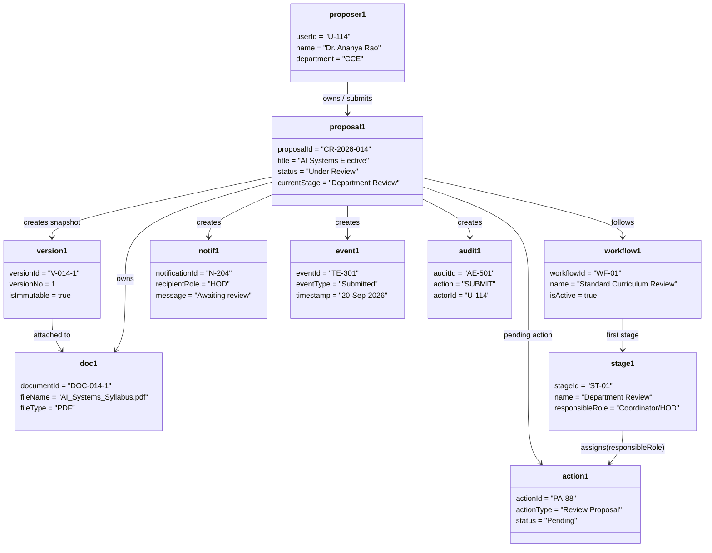
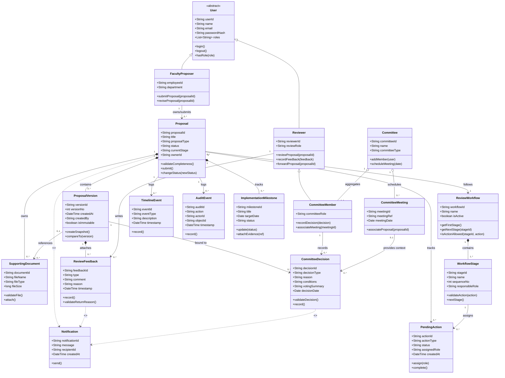

# The LNM Institute of Information Technology, Jaipur
## Software Development Laboratory
**Course Code:** CS314  
**Lab Assignment 4:** Classes, Object Diagram and Relationships  
**Project:** Curriculum Revision Management System  
**Team ID:** T017  
**Team Members:** Utkarsh, Piyush, Yash, Mehul  
**Roll Numbers:** 24UCC096, 24UCC097, 24UCC099, 24UCC100  
**Development Model:** Agile - Iterative and Incremental Development  
**Date:** 20 September 2026  

---

## 36. Classes

The system domain model comprises 17 primary classes mapped directly to the requirements baseline established in SRS v1.0.

| Class | Key Attributes | Key Operations | Traces to |
|---|---|---|---|
| **User** *(abstract)* | `userId`, `name`, `email`, `passwordHash`, `roles` | `login()`, `logout()`, `hasRole()` | FR-001–006 |
| **FacultyProposer** | `employeeId`, `department` | `submitProposal()`, `reviseProposal()` | FR-015–016, UC-005 |
| **Reviewer** | `reviewerId`, `reviewRole` | `reviewProposal()`, `recordFeedback()`, `forwardProposal()` | FR-019–024, UC-009 |
| **CommitteeMember** | `committeeRole` | `recordDecision()`, `associateMeeting()` | FR-031–034, UC-015 |
| **Proposal** | `proposalId`, `title`, `proposalType`, `status`, `currentStage`, `ownerId` | `validateCompleteness()`, `submit()`, `changeStatus()` | FR-015–024, BR-003–004 |
| **ProposalVersion** | `versionId`, `versionNo`, `createdAt`, `createdBy`, `isImmutable` | `createSnapshot()`, `compareTo()` | FR-025–027, BR-005–006 |
| **SupportingDocument** | `documentId`, `fileName`, `fileType`, `fileSize` | `validateFile()`, `attach()` | FR-013, UC-006, SRS §16.10 |
| **ReviewWorkflow** | `workflowId`, `name`, `isActive` | `getFirstStage()`, `getNextStage()`, `isActionAllowed()` | FR-008, FR-018, FR-024 |
| **WorkflowStage** | `stageId`, `name`, `sequenceNo`, `responsibleRole` | `validateAction()`, `nextStage()` | FR-018, FR-024, BR-007/010 |
| **PendingAction** | `actionId`, `actionType`, `status`, `assignedRole`, `createdAt` | `assign()`, `complete()` | FR-017–018, FR-037 |
| **ReviewFeedback** | `feedbackId`, `type`, `comment`, `reason`, `timestamp` | `record()`, `validateReturnReason()` | FR-020–022, BR-008/010 |
| **Committee** | `committeeId`, `name`, `committeeType` | `addMember()`, `scheduleMeeting()` | FR-031–034 |
| **CommitteeMeeting** | `meetingId`, `meetingRef`, `meetingDate` | `associateProposal()` | FR-031, UC-015 |
| **CommitteeDecision** | `decisionId`, `decisionType`, `reason`, `conditions`, `votingSummary`, `decisionDate` | `validateDecision()`, `record()` | FR-032–034, BR-008/009/014 |
| **Notification** | `notificationId`, `message`, `recipientId`, `createdAt` | `send()` | FR-036, UC-005/009/015 |
| **TimelineEvent** | `eventId`, `eventType`, `description`, `timestamp` | `record()` | FR-045, UC-005/009/015 |
| **AuditEvent** | `auditId`, `action`, `actorId`, `objectId`, `timestamp` | `record()` | FR-047, UC-005/009/015 |
| **ImplementationMilestone** | `milestoneId`, `title`, `targetDate`, `status` | `update()`, `attachEvidence()` | FR-038–041, US-013, UC-019, SRS §16.19 |

> **SRS Data-Model Naming Note:**  
> `Proposal` corresponds to `CurriculumProposal` (SRS §16.8), `ReviewWorkflow` to `WorkflowDefinition` (§16.11), `ReviewFeedback` to `Feedback` (§16.15), and `CommitteeDecision` to `Decision` (§16.17).

---

## 37. Object Diagram

### UC-005 (Submit Proposal) — Instance Snapshot
The object diagram below captures the exact system runtime state immediately following the execution of **UC-005 (Submit Proposal)** by Dr. Ananya Rao:

**Snapshot Description:**  
Dr. Ananya Rao (`proposer1`) submits the curriculum revision proposal `CR-2026-014` for a new AI Systems elective. The system validates `proposal1`, creates immutable `version1`, and moves the proposal to the first active workflow stage, *Department Review*. The supporting syllabus document `doc1` remains owned by `proposal1` and is linked to `version1` as the submitted version; `action1` is assigned to the Programme Coordinator/HOD. `notif1`, `event1`, and `audit1` record the notification, timeline, and audit consequences of the submission. This represents the postcondition snapshot immediately after the main flow of UC-005.

---

## 38. Relationships

### Generalization / Inheritance
- **`FacultyProposer` and `Reviewer` specialize `User`** (inherit from abstract parent class `User`) because both share authenticated user identity, session management, and role-based access behavior (FR-001–006).
- **`CommitteeMember` specializes `Reviewer`** because a committee member performs review actions and additionally possesses authority to record formal committee decisions in UC-015.

### Composition
- **`Proposal` "1" \*-- "0..\*" `ProposalVersion`:** Each submitted or resubmitted snapshot belongs to exactly one proposal and cannot exist without it (FR-025, BR-005–006).
- **`Proposal` "1" \*-- "0..\*" `SupportingDocument`:** Uploaded documents are lifecycle-owned by the proposal, including draft attachments (FR-013, UC-006, SRS §16.10).
- **`ReviewWorkflow` "1" \*-- "1..\*" `WorkflowStage`:** Configured stages are integral structural parts of a review workflow defining the review progression (FR-008, FR-024).
- **`ProposalVersion` "1" \*-- "0..\*" `ReviewFeedback`:** Review comments and requested revisions are stored strictly in the context of the proposal version being scrutinized (FR-020, FR-030).
- **`Proposal` "1" \*-- "0..\*" `ImplementationMilestone`:** Milestones track execution of an approved proposal (FR-038–041, US-013, UC-019).

### Aggregation
- **`Committee` "1" o-- "1..\*" `CommitteeMember`:** Members are grouped within a committee but exist independently as users/reviewers outside the committee life.
- **`Committee` "1" o-- "0..\*" `CommitteeMeeting`:** Committees maintain scheduled meetings, each remaining an independent entity.

### Association
- **`FacultyProposer` "1" -- "0..\*" `Proposal`:** owns and initiates proposals (UC-005).
- **`Proposal` "0..\*" -- "1" `ReviewWorkflow`:** follows the configured academic approval path (FR-018, FR-024).
- **`WorkflowStage` "1" -- "0..\*" `PendingAction`:** determines which role receives pending tasks.
- **`Proposal` "1" -- "0..\*" `PendingAction`:** proposal tracks pending actions across its lifecycle.
- **`Reviewer` "1" -- "0..\*" `ReviewFeedback`:** reviewers write comments, recommendations, or return reasons (FR-020).
- **`CommitteeMember` "1" -- "0..\*" `CommitteeDecision`:** committee members submit formal decisions (FR-032–034).
- **`CommitteeMeeting` "0..1" -- "0..\*" `CommitteeDecision`:** provides contextual meeting minutes/dates (FR-031).
- **`ProposalVersion` "1" -- "0..\*" `CommitteeDecision`:** decisions are bound to specific proposal versions.
- **`ProposalVersion` "0..1" -- "0..\*" `SupportingDocument`:** links versions to relevant attachments.
- **`Proposal` "1" -- "0..\*" `TimelineEvent`:** chronological sequence of events (FR-045).
- **`Proposal` "1" -- "0..\*" `AuditEvent`:** system-level audit logs with actors and timestamps (FR-047).

### Dependency
- **`Proposal` ..> `Notification` \<\<creates\>\>:** Submission triggers alerts to assigned reviewers (UC-005, FR-036).
- **`ReviewFeedback` ..> `Notification` \<\<creates\>\>:** Completed reviews notify the proposer or next stage owner (UC-009, FR-036).
- **`CommitteeDecision` ..> `Notification` \<\<creates\>\>:** Recorded decisions notify the Academic Office, Proposer, and relevant authorities (UC-015, FR-036).

---

### Complete UML Class Diagram

---

## 39. Individual Contribution

- **Utkarsh (24UCC096):** Identified the classes and traced them to the three detailed use cases and corresponding SRS requirements.
- **Piyush (24UCC097):** Prepared the UML Class Diagram and verified multiplicities and inheritance relationships.
- **Yash (24UCC099):** Prepared the Object Diagram for UC-005 and wrote the snapshot description.
- **Mehul (24UCC100):** Documented and justified the class relationships and performed the final consistency checks.

---

## AI Usage Policy — Student Declaration

AI tools may be used as supporting tools for this assignment. The team is responsible for the correctness, consistency, and understanding of all submitted classes, objects, and relationships.
- We have disclosed the use of AI tools, if any.
- AI-generated suggestions have been reviewed, verified, and adapted by the team.
- We understand and can explain the submitted classes, object diagram, and relationships.
- We have verified that the UML models are consistent with our project's requirements, use cases, and scope.
- The final submission represents our team's understanding and modeling decisions.

| Item | Details |
|---|---|
| **AI Tool(s) Used** | ChatGPT / AI Assistant |
| **Purpose of AI Use** | Used for structuring the assignment, checking consistency with Assignments 2 and 3, and drafting the UML diagrams. All final modeling decisions were reviewed by the team. |
| **Team ID** | T017 |
| **Team Representative** | YASH GUPTA |
| **Date** | 20 September 2026 |
