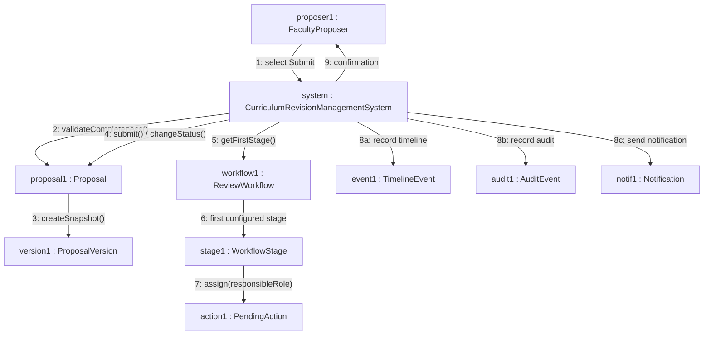
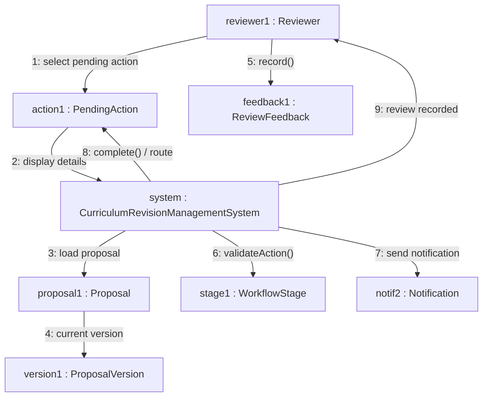
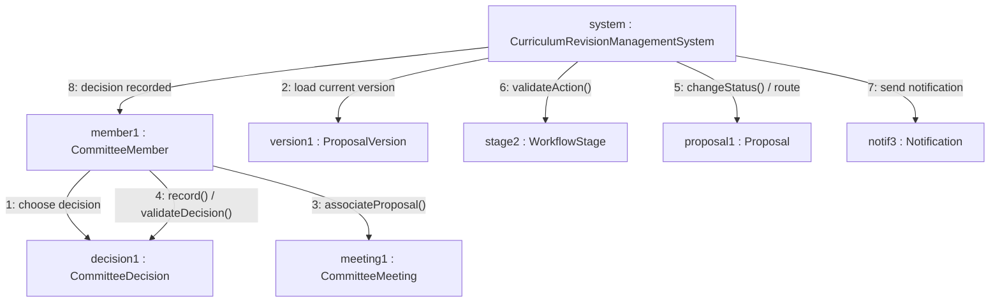
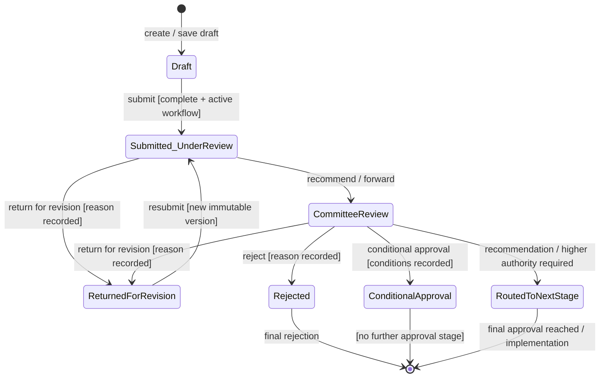
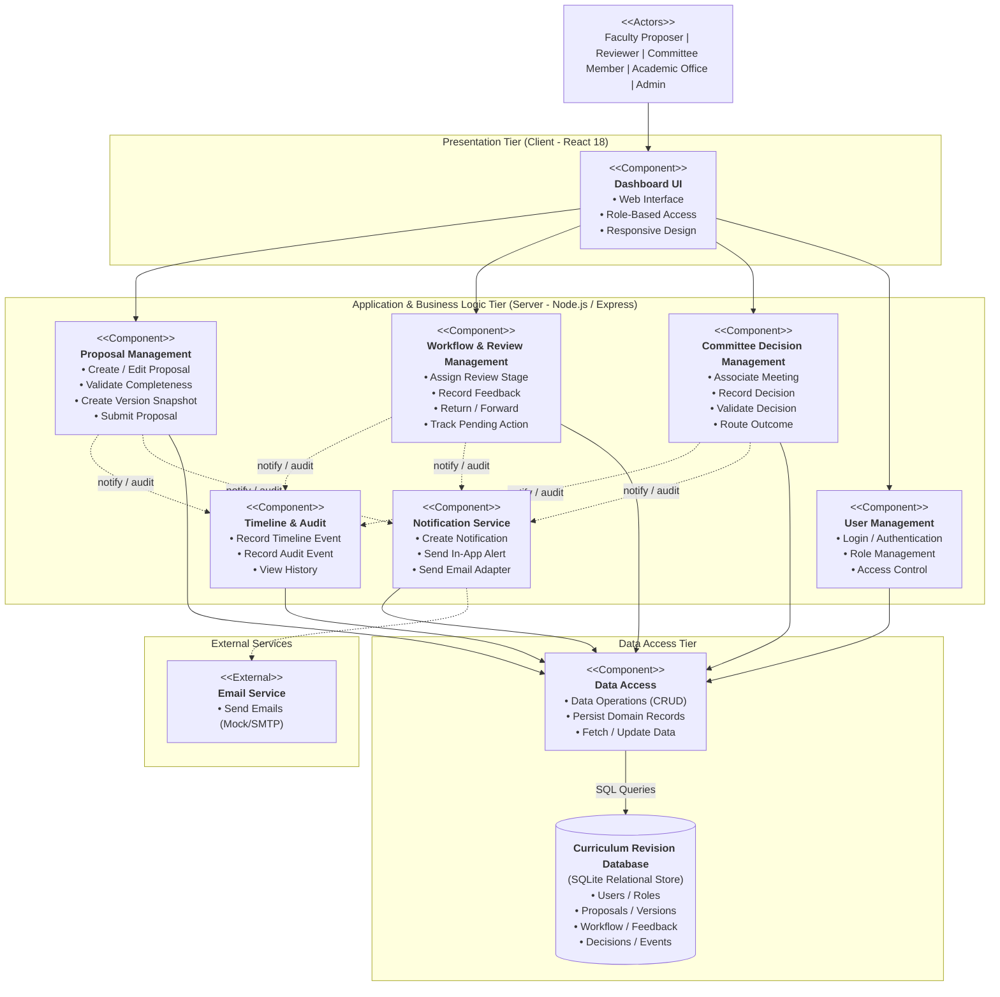

# The LNM Institute of Information Technology, Jaipur
## Software Development Laboratory
**Course Code:** CS314  
**Lab Assignment 5:** Collaboration, State and Component Modelling  
**Project:** Curriculum Revision Management System  
**Team ID:** T017  
**Team Members:** Utkarsh, Piyush, Yash, Mehul  
**Roll Numbers:** 24UCC096, 24UCC097, 24UCC099, 24UCC100  
**Development Model:** Agile - Iterative and Incremental Development  
**Date:** 29 September 2026  

---

## 40. Collaboration Diagrams (Communication Diagrams)

### 40.1 UC-005 — Submit Proposal

The collaboration diagram models the runtime message exchanges among collaborating objects during the submission of a curriculum proposal by the Faculty Proposer.

**Message Sequence Description:**
1. `proposer1` initiates submission by invoking `select Submit` on `system`.
2. `system` invokes `validateCompleteness()` on `proposal1` to ensure all mandatory academic attributes are populated.
3. Upon successful validation, `proposal1` calls `createSnapshot()` to instantiate `version1` as an immutable version.
4. `system` invokes `submit() / changeStatus()` on `proposal1` to update state to `Submitted / Under Review`.
5. `system` calls `getFirstStage()` on `workflow1` to determine the initial approval tier.
6. `workflow1` returns `stage1` (e.g., Department Review).
7. `stage1` invokes `assign(responsibleRole)` to generate and allocate `action1: PendingAction` to the designated role (HOD).
8. `system` concurrently dispatches operational artifacts:
   - `8a: record timeline` to create `event1: TimelineEvent`.
   - `8b: record audit` to persist `audit1: AuditEvent`.
   - `8c: send notification` to dispatch `notif1: Notification`.
9. `system` returns submission confirmation to `proposer1`.

---

### 40.2 UC-009 — Review Proposal and Record Feedback

The collaboration diagram models the interactions that occur when an authorized departmental or committee reviewer evaluates a proposal and records recommendations or returns it for revisions.

**Message Sequence Description:**
1. `reviewer1` clicks `select pending action` on their assigned `action1`.
2. `action1` requests the `system` to display action and proposal details.
3. `system` loads `proposal1`.
4. `proposal1` retrieves `version1` (active immutable version) and associated syllabus documents.
5. `reviewer1` enters comments or return reasons and calls `record()` on `feedback1`.
6. `system` verifies via `stage1.validateAction()` that the action (Forward/Return) is legitimate for the current stage.
7. `system` triggers `send notification` to `notif2` alerting the proposer or next committee.
8. `system` marks `action1` completed via `complete() / route` and transitions the workflow.
9. `system` confirms review completion to `reviewer1`.

---

### 40.3 UC-015 — Record Committee Decision

The collaboration diagram depicts the formal decision recording process conducted by a committee member during scheduled curriculum review meetings.

**Message Sequence Description:**
1. `member1` opens decision portal and invokes `choose decision` on `decision1`.
2. `system` loads `version1` of the proposal.
3. `member1` binds the decision to `meeting1` using `associateProposal()`.
4. `member1` populates decision reason, conditions, or voting summary and executes `record() / validateDecision()`.
5. `system` executes `changeStatus() / route` on `proposal1` (e.g., Conditional Approval or Forward to Senate).
6. `system` validates stage progression against `stage2.validateAction()`.
7. `system` generates event alert `send notification` to `notif3`.
8. `system` returns confirmation `decision recorded` to `member1`.

---

## 41. State Diagrams

### 41.1 Proposal Object — State Lifecycle (UC-005 / UC-009 / UC-015)

The lifecycle of the `Proposal` domain object is governed strictly by workflow actions, version freezing, and committee determinations:

**State Transitions and Rules:**
- **`Draft`:** The proposal is editable by the owner. It can be saved repeatedly without creating versions (BR-003).
- **`Submitted / Under Review`:** Triggered by `submit [complete + active workflow]`. Completeness validation is enforced (BR-004), creating an immutable version snapshot (BR-005). The proposal is no longer editable directly.
- **`Returned for Revision`:** Reviewer returns proposal. Transition requires a mandatory recorded reason (BR-008). The proposal becomes editable again by the owner.
- **`Resubmission`:** Initiated from `Returned for Revision`. Generates a new immutable version increment (`v2`, `v3`) while preserving historical versions (BR-006).
- **`Committee Review`:** Formal evaluation by Department Curriculum Committee or Board of Studies.
- **Terminal & Downstream States:**
  - **`Rejected`:** Requires formal rejection reason (BR-008); lifecycle terminates.
  - **`Conditional Approval`:** Requires recorded conditions (BR-009).
  - **`Routed to Next Stage`:** Higher institutional authority required (e.g., Senate / Academic Council).

---

### 41.2 PendingAction Object — State Lifecycle (UC-005 / UC-009 / UC-015)

```mermaid
stateDiagram-v2
    [*] --> Created : proposal enters review stage
    Created --> Assigned : assign(responsibleRole)
    Assigned --> Pending : available to responsible role
    Pending --> Pending : invalid / stale / unauthorized action [blocked]
    Pending --> Completed : valid review / decision action; complete()
    Completed --> [*] : action closed
```

**State Transitions and Rules:**
- **`Created`:** Instantiated automatically when a proposal advances to a new review stage.
- **`Assigned`:** Bound to the specific role or committee responsible for the active workflow stage.
- **`Pending`:** Visible on the responsible user's dashboard. A stale or unauthorized action attempt is blocked and refreshes the view.
- **`Completed`:** Terminal state reached when a valid review action or committee decision is executed and confirmed.

---

## 42. Component Diagram

The component architecture represents a modular, service-oriented multi-tier design separating presentation, business logic, workflow automation, audit tracking, data persistence, and external adapters:

---

## 43. Individual Contribution

- **Utkarsh (24UCC096):** Prepared and reviewed the UC-005 collaboration diagram and verified consistency with Assignment 4 classes.
- **Piyush (24UCC097):** Prepared the UC-009 collaboration diagram and the Proposal state diagram.
- **Yash (24UCC099):** Prepared the UC-015 collaboration diagram and the component diagram.
- **Mehul (24UCC100):** Prepared the PendingAction state diagram and performed final UML consistency and presentation checks.

---

## AI Usage Policy — Student Declaration

AI tools may be used as supporting tools for this assignment. The team is responsible for the correctness, consistency, and understanding of all submitted collaboration, state, and component models.
- We have disclosed the use of AI tools, if any.
- AI-generated suggestions have been reviewed, verified, and adapted by the team.
- We understand and can explain the submitted collaboration diagrams, state diagrams, and component diagram.
- We have verified that the UML models are consistent with our project requirements, use cases, classes, objects, and scope.
- The final submission represents our team understanding and modeling decisions.

| Item | Details |
|---|---|
| **AI Tool(s) Used** | ChatGPT / AI Assistant |
| **Purpose of AI Use** | Used for structuring the assignment, drafting UML diagrams, and checking consistency with Assignments 2 to 4. Final diagrams were reviewed by the team. |
| **Team ID** | T017 |
| **Team Representative** | YASH GUPTA |
| **Date** | 29 September 2026 |
